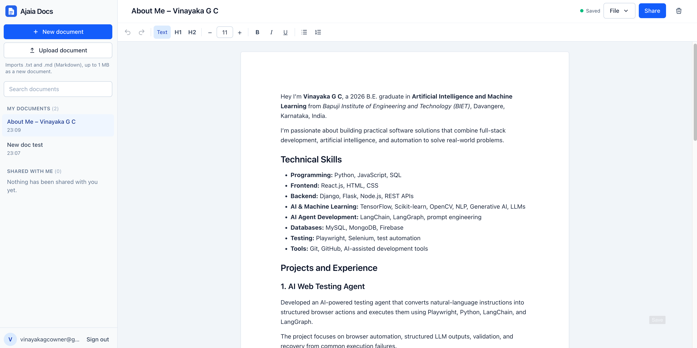
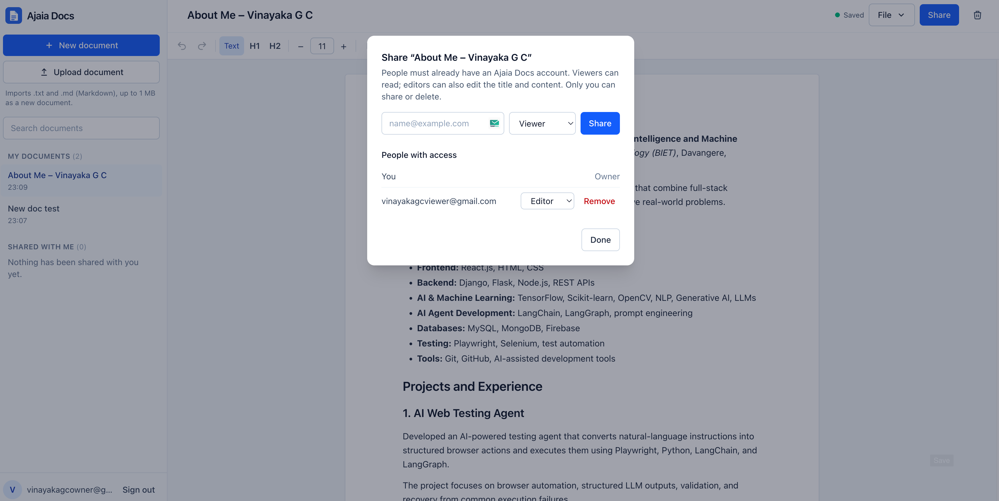
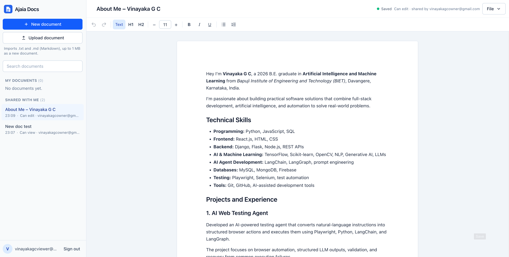
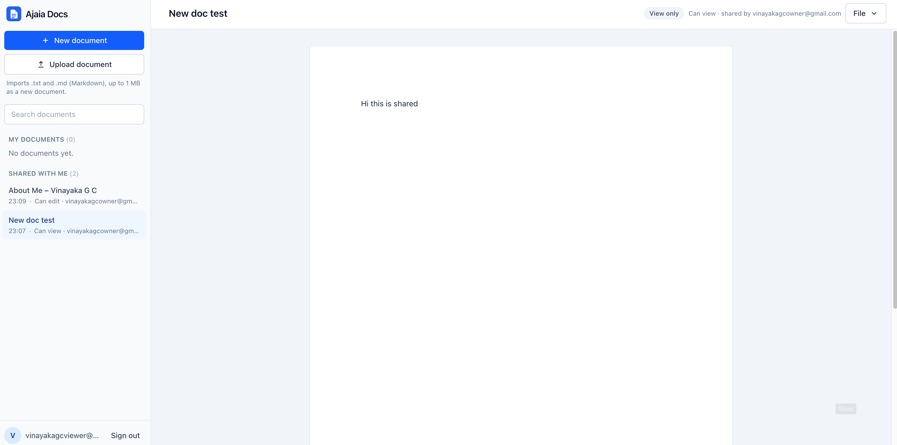

# Ajaia Docs

A lightweight document editor inspired by Google Docs. You can create, format, rename and autosave documents, import `.txt` and `.md` files, and share documents with other registered users as **viewers** or **editors**. Access control is enforced in PostgreSQL with Row Level Security (RLS), not in the UI.

> This is not real-time collaboration. Each save is persisted, and shared users see the latest saved version when they open or reopen a document. If two people edit the same document at the same time, the last write wins (see [ARCHITECTURE.md](ARCHITECTURE.md)).

## Features

- Email/password sign-up, sign-in and sign-out (Supabase Auth). The session is restored on reload.
- **My Documents** and **Shared with Me** lists, with search by title or owner email.
- Create, rename, edit and delete documents. Delete is owner-only and asks for confirmation.
- A rich-text editor (Tiptap) with bold, italic, underline, H1, H2, normal text, bulleted and numbered lists, font size, and undo/redo. Keyboard shortcuts work, and toolbar buttons show the active formatting.
- Debounced autosave with a status indicator: *Unsaved changes → Saving… → Saved*, or *Not saved* with a Retry button. "Saved" is shown only after the database confirms the write.
- Import `.txt`, `.md` and `.markdown` files up to 1 MB. Markdown headings, lists, bold, italic, code, quotes and rules are converted into editor formatting. Other file types, empty files, binary files and oversized files are rejected with a clear message.
- Sharing by email with Viewer (read) or Editor (read and edit) access. The owner can change or remove access.
- **A4 pages with gaps, like Google Docs.** On desktop, documents are laid out on separate A4 sheets (794 × 1123 px, 1-inch margins) with a grey gap between them. Any paragraph, heading or list item that would cross the bottom of a page moves to the top of the next page. Printing breaks at exactly the same places.
- **Font size** control (`–  11  +`, or type a size) in points, 6–96 pt. The defaults are 11 pt for body text and 20/16/14 pt for H1/H2/H3, as in Google Docs.
- **File menu.** Download as Markdown (`.md`), plain text (`.txt`) or HTML (`.html`); **Print / Save as PDF**, which uses real A4 pages; and **Make a copy** (the "Save as" action), which creates a copy that you own. Viewers can also download, print and copy.
- The open document is kept in the URL (`?doc=<id>`), so a refresh reopens it.
- Responsive layout: on small screens the sidebar becomes a drawer.

## Screenshots

| Owner editing | Share dialog |
| --- | --- |
|  |  |
| **Recipient with edit access** | **Recipient with view-only access** |
|  |  |

**Live app:** https://ajaia-docs-olive-one.vercel.app/ · **Walkthrough video:** https://www.loom.com/share/5ea3aab7624e4789a206aebd67406f8e

## Tech stack

React 19, TypeScript, Vite 8, Tailwind CSS 4, Tiptap 3 (StarterKit), Supabase (Postgres, Auth, RLS) and `@supabase/supabase-js`. Tests use Vitest, React Testing Library and PGlite (Postgres compiled to WASM) for the database tests. There is no custom backend server.

## Prerequisites

- Node.js 20.19 or newer (developed on Node 24) and npm
- A Supabase project (the free tier is fine)
- Optional: a Vercel account for deployment

## Local setup

```bash
npm install
cp .env.example .env.local   # then fill in the two values below
npm run dev                  # http://localhost:5173
```

If the environment variables are missing, the app shows a "Supabase is not configured" screen instead of crashing.

### Environment variables

| Variable | Where to find it |
| --- | --- |
| `VITE_SUPABASE_URL` | Supabase → Project Settings → API → Project URL |
| `VITE_SUPABASE_ANON_KEY` | Supabase → Project Settings → API → `anon` / publishable key |

Only the **public** anon/publishable key goes in the frontend. It is safe to expose because every table is protected by RLS. **Never** put the `service_role`/secret key in `.env.local`, Vercel or the repository.

## Supabase setup

1. Create a project at [supabase.com](https://supabase.com).
2. Apply the schema. Open **SQL Editor**, paste the full contents of [`supabase/migrations/20261012000000_init.sql`](supabase/migrations/20261012000000_init.sql) and run it. If you use the Supabase CLI instead: `supabase link --project-ref <ref>` then `supabase db push`.
3. Under **Authentication → Providers → Email**, keep Email enabled. For a frictionless demo you can turn off **Confirm email**. If you leave it on, new users must click the confirmation link before they can sign in. The built-in mailer is rate-limited.
4. Under **Authentication → URL Configuration**, set **Site URL** to your deployed URL (or `http://localhost:5173` for local use) so confirmation links point back to the app.

The migration creates `profiles`, `documents` and `document_shares`, plus the RLS policies, column-level grants, helper functions and the `share_document` RPC. It also backfills a profile for any users that already exist.

### Reviewer test accounts

No credentials are committed to this repository. Create two accounts in either of these ways:

- **Dashboard:** go to Authentication → Users → *Add user* → *Create new user*, enter an email and a strong password, and tick **Auto Confirm User**. Do this twice, for example `reviewer.owner@<your-domain>` and `reviewer.recipient@<your-domain>`.
- **In the app:** click *Create an account* on the sign-in screen. This works without extra steps when **Confirm email** is off.

A profile row is created automatically for every new user by a trigger. Sharing is by email, so the recipient must have signed up first.

## Scripts

| Command | What it does |
| --- | --- |
| `npm run dev` | Starts the Vite dev server. |
| `npm run build` | Type-checks (`tsc -b`) and builds the production bundle into `dist/`. |
| `npm run preview` | Serves the production build locally. |
| `npm run lint` | Runs ESLint. |
| `npm run typecheck` | Runs the TypeScript project build with no output. |
| `npm test` | Runs all automated tests: unit, component and PGlite RLS tests. No network is needed. |
| `npm run test:live` | Runs integration checks against your **real** Supabase project (see below). |

### Tests

`npm test` runs three kinds of tests. They prove different things:

1. **Database authorization (`supabase/tests/rls.test.ts`).** These run the real migration on real PostgreSQL (PGlite). Queries execute as the `authenticated` role with a per-request `auth.uid()`, which is how Supabase evaluates RLS. They cover owner, viewer, editor and unrelated-user access, ownership changes, duplicate shares and anonymous access. A small shim emulates Supabase's `auth` schema and default grants ([`supabase/tests/supabase-shim.sql`](supabase/tests/supabase-shim.sql)). Because of that shim, these tests are not a test of a hosted Supabase instance.
2. **Unit tests.** These cover autosave timing and race handling, file validation, Markdown conversion, rich-text JSON round-trips through a real headless Tiptap editor, permission rules, and the data-access layer with a fake client.
3. **Component tests (React Testing Library).** These cover creating a document, the list and search, rejected and accepted uploads, viewer read-only mode, editor mode, autosave status and the toolbar. The API layer is mocked in these tests, so they verify UI behaviour only.

`npm run test:live` ([`scripts/live-smoke.mjs`](scripts/live-smoke.mjs)) signs in as two real users with the anon key and checks the following against the hosted database: persistence, formatting round-trip, sharing, viewer and editor rules, protection of private documents, and that anonymous users are denied. It needs these variables in `.env.local`:

```
SMOKE_A_EMAIL=...  SMOKE_A_PASSWORD=...  SMOKE_B_EMAIL=...  SMOKE_B_PASSWORD=...
```

It creates two temporary documents and deletes them at the end.

## Deployment (Vercel)

1. Push the repository to GitHub, GitLab or Bitbucket and click **Import** in Vercel. Alternatively, run `npx vercel` from the project root.
2. Vercel detects the framework as **Vite**: the build command is `npm run build` and the output directory is `dist`.
3. Add `VITE_SUPABASE_URL` and `VITE_SUPABASE_ANON_KEY` under **Settings → Environment Variables**, for Production and Preview. Then redeploy, because Vite inlines these values at build time.
4. In Supabase, set **Site URL** to the Vercel URL (see Supabase setup, step 4).
5. In a fresh browser session, sign in as each reviewer account and walk through the flows.

No rewrites are needed, because the app uses a query parameter (`?doc=`) rather than client-side routes.

## Project structure

```
src/
  components/          Shared UI: Modal, ConfirmDialog, Spinner, Logo
  features/
    auth/              AuthProvider (session restore), AuthScreen
    documents/         Data access (documentsApi), Workspace, Sidebar, DocumentView
    editor/            Tiptap config, Toolbar, FontSizeControl, AutosaveController, DocumentEditor, A4 pagination (pageLayout + paginationExtension)
    export/            Markdown/text/HTML export, File menu
    import/            File validation and Markdown/plain text → Tiptap JSON
    sharing/           sharingApi, ShareDialog, permission → UI capabilities
  lib/                 Supabase client, error messages
  types/               Shared domain types
  test/                Test setup and helpers
supabase/
  migrations/          Version-controlled schema and RLS
  tests/               PGlite RLS tests and Supabase shim
scripts/live-smoke.mjs Integration checks against a real Supabase project
```

## Known limitations

- **No real-time collaboration or conflict resolution.** Concurrent editors overwrite each other (last write wins). Others see changes only when they open or reopen the document. Refocusing the window refreshes the document *lists*, not an open document.
- **Email enumeration.** The owner of any document can learn whether an email address is registered, because sharing with an unknown address returns an error. This is acceptable for a demo. Invitations would remove it.
- **Markdown import is a subset.** Nested lists are flattened. Tables, links and images are kept as literal text. Headings deeper than H3 become H3. Only `.txt` and `.md` are supported; `.docx` and `.pdf` are not.
- **Limited sharing actions for recipients.** A recipient cannot remove a document from their own "Shared with Me" list; only the owner can revoke access. There is no ownership transfer and no link sharing.
- **Pagination works per block.** A paragraph moves to the next page as a whole; it is never split line by line the way Google Docs does it, so a long paragraph near the end of a page can leave white space. A single paragraph taller than a whole page can't fit anywhere, so it runs across the gap. Page layout applies only on screens 640 px wide or more; on phones the document is one continuous sheet.
- **Font sizes are not exported to Markdown or plain text**, because neither format has a way to represent them. HTML export and printing keep them.
- **Markdown export** writes underline as `<u>…</u>`, because Markdown has no underline syntax. The app's importer reads it back as underline. Nested lists are exported with indentation but flattened on re-import.
- **No version history.**
- The production JavaScript bundle is 884 kB (266 kB gzipped) in a single chunk, mostly react-dom, supabase-js and Tiptap/ProseMirror. Code-splitting the editor and auth screens would reduce the initial load.
- Large documents (close to the 1 MB import limit) serialize the full document JSON on every autosave.
